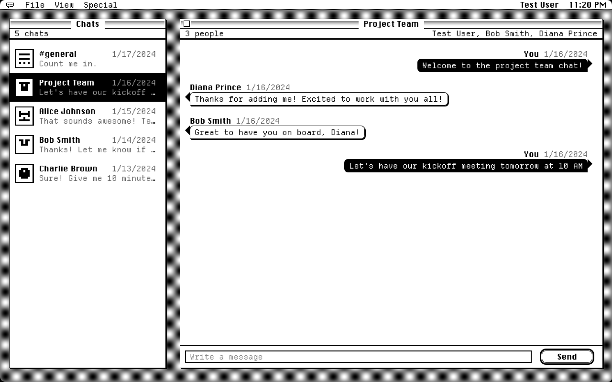
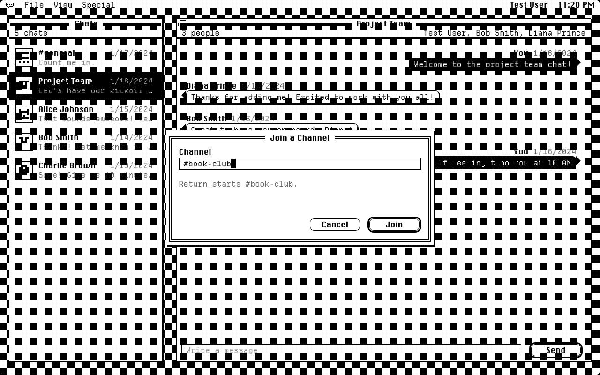
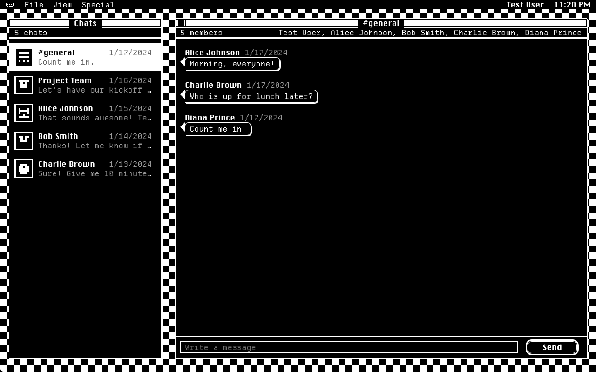

# Msgr

**Chat with the people you know, on a black-and-white Macintosh.**

[](https://github.com/willeasp/msgr/actions/workflows/ci.yml)



## What it does

- **Invite-only.** Nobody can sign up without a link from someone already in. File → Invite a Friend… makes one; it works once and lasts a week. Whoever signs up with it lands in a chat with you, and you get told they joined.
- **Direct chats, groups and `#channels`.** Start a chat with anyone. Make a channel with File → New Channel…, bring people in with Add People…, or join one from File → Join Channel… or by typing `/join #name` in the message box.
- **Live.** Messages arrive the moment they're sent, and the chat list reorders itself.
- **Desktop notifications** and a beep for messages in chats you aren't looking at. Turn them on in the Special menu.
- **Light, dark and seven tints** from the View menu, and a layout that works on a phone.
- **Free to host.** One container on Render's free plan, with Neon's free Postgres.

<p>
  
  
</p>
<p>
  
  
</p>

## Run it locally

You need Node.js 22 or newer. The database comes from Prisma's local dev server, so there's no Postgres to install.

```bash
npm install
npm run db:start          # in its own terminal; press h for its URL, and keep it running
cp apps/api/.env.example apps/api/.env   # then set DATABASE_URL to that URL
npm run db:setup          # migrate, generate the Prisma client, seed
npm run dev               # API on :4000, app on http://localhost:4200
```

The app proxies `/graphql` to the API, the same single-address setup production uses. Run `npm run db:migrate` whenever you pull a new migration.

The seed creates five people, all with the password `password123`, and five chats: three direct, the "Project Team" group and `#general`.

| Email               | Name          |
| ------------------- | ------------- |
| test@example.com    | Test User     |
| alice@example.com   | Alice Johnson |
| bob@example.com     | Bob Smith     |
| charlie@example.com | Charlie Brown |
| diana@example.com   | Diana Prince  |

## Invite people

Signed in, use **File → Invite a Friend…** and send the link. With nobody signed up yet, print the first one from the command line:

```bash
npm run invite
```

## Deploy for free

Msgr runs as one container: the API serves the built app from its own address, so one session cookie covers both. [Render](https://render.com)'s free web service runs it and [Neon](https://neon.com)'s free Postgres keeps the data (Render's own free database expires after 30 days). Free plans change, so check both pricing pages.

1. **Database.** Create a Neon project and copy its _direct_ connection string (turn connection pooling off); it starts with `postgresql://`.
2. **App.** In Render, choose **New → Blueprint** and pick this repository; `render.yaml` describes the service. Paste the Neon string as `DATABASE_URL`. Render generates `JWT_SECRET`, and the app learns its own address from Render. Migrations run on every start.
3. **First invite.** From your machine, against the production database:

   ```bash
   DATABASE_URL='<neon connection string>' CORS_ORIGIN='https://<your-app>.onrender.com' npm run invite
   ```

   Open the link, sign up, and invite everyone else from **File → Invite a Friend…**.

On the free plan the app sleeps after 15 minutes without visitors: the next visit takes about a minute to wake it, and open tabs reconnect by themselves. Any host that runs a container works the same way; to try the production image locally:

```bash
docker build -t msgr .
docker run -p 4000:4000 -e DATABASE_URL='postgresql://…' \
  -e JWT_SECRET="$(openssl rand -base64 32)" -e CORS_ORIGIN=http://localhost:4000 msgr
```

## How it's built

- **API:** Node, Express and Apollo Server; GraphQL over HTTP and, for the live feed, over WebSocket. Prisma on PostgreSQL, DataLoader for batching. It's a functional core with an imperative shell: pure domain rules, use cases behind ports, and adapters at the edges.
- **App:** React 19, Apollo Client and Vite, built from [Sacred Computer](https://www.sacred.computer/)'s components and dressed as a 1984 Macintosh by one skin stylesheet. Set in Chicago and Departure Mono.
- **Security:** invite-only accounts, an httpOnly session cookie for HTTP and WebSocket alike, a strict Content-Security-Policy, and throttled logins. See [SECURITY.md](SECURITY.md).
- **Tooling:** an Nx monorepo, Vitest, and GitHub Actions running every check, including the repository contract against real Postgres.

Read more:

- [docs/architecture.md](docs/architecture.md): the big picture, and how a message travels.
- [docs/adr/](docs/adr/): why it's built this way, one decision at a time.
- [CLAUDE.md](CLAUDE.md): conventions, the TDD workflow and gotchas, for anyone changing the code.
- [CONTEXT.md](CONTEXT.md): the vocabulary: chat, channel, participant, invite.
- [docs/manual-testing.md](docs/manual-testing.md): a checklist for trying every feature by hand.

## Scripts

| Script                | What it does                                                              |
| --------------------- | ------------------------------------------------------------------------- |
| `npm run dev`         | API and app in parallel (`dev:api`, `dev:frontend`)                       |
| `npm run test`        | Every test; the Postgres contract also runs if `TEST_DATABASE_URL` is set |
| `npm run typecheck`   | Type check both apps (runs codegen first)                                 |
| `npm run lint`        | Lint both apps, including the API's layer rule                            |
| `npm run build`       | Build both apps                                                           |
| `npm run codegen`     | Generate GraphQL types for the API and the app                            |
| `npm run db:start`    | Start the Prisma dev database                                             |
| `npm run db:migrate`  | Apply migrations (and create one after a schema change)                   |
| `npm run db:generate` | Generate the Prisma client                                                |
| `npm run db:seed`     | Reset chats and seed test data                                            |
| `npm run db:setup`    | migrate + generate + seed                                                 |
| `npm run invite`      | Print a single-use sign-up link                                           |

## Project structure

```
apps/
├── api/
│   ├── prisma/              # schema, migrations, seed
│   ├── scripts/             # create-invite (npm run invite)
│   └── src/
│       ├── domain/          # pure types and rules (functional core)
│       ├── application/     # use cases, ports, DataLoaders
│       ├── infrastructure/  # Prisma, bcrypt, JWT, PubSub and throttle adapters
│       ├── graphql/         # schema, resolvers, context, server
│       ├── testing/         # in-memory adapters, repository contract, test harness
│       └── main.ts          # composition root
└── frontend/
    ├── public/              # fonts, boot script
    └── src/
        ├── app/             # pages, Mac chrome, chat windows and dialogs, hooks
        ├── lib/             # pure logic with tests, generated GraphQL types
        ├── sacred/          # vendored Sacred Computer components
        └── skin.css         # the Macintosh skin
docs/                        # architecture, decision records, screenshots
Dockerfile, render.yaml      # one container, deployed for free
```

## Troubleshooting

**Database connection issues?** Make sure `npm run db:start` is running and ports 51213–51215 are free.

**TypeScript errors after pulling?** Run `npm run codegen` and `npm run db:generate`, and `npm run db:migrate` if there are new migrations.

**Live updates not arriving?** Sign out and in again (the session cookie authenticates the WebSocket), and check the API is running.

## Credits

The interface is built from [Sacred Computer](https://www.sacred.computer/) by Internet Development Studio (MIT; see `apps/frontend/src/sacred/LICENSE.md`), and set in Chicago FLF and Departure Mono from Sacred's font menu. The look is a homage to the original Macintosh; Msgr has nothing to do with Apple, and its icons are its own.
