<div align="center">


# Msgr

**Chat with the people you know, on a black-and-white Macintosh.**

[](https://github.com/willeasp/msgr/actions/workflows/ci.yml)


</div>

<picture>
  <source media="(prefers-color-scheme: dark)" srcset="docs/screenshots/desktop-dark.png">
  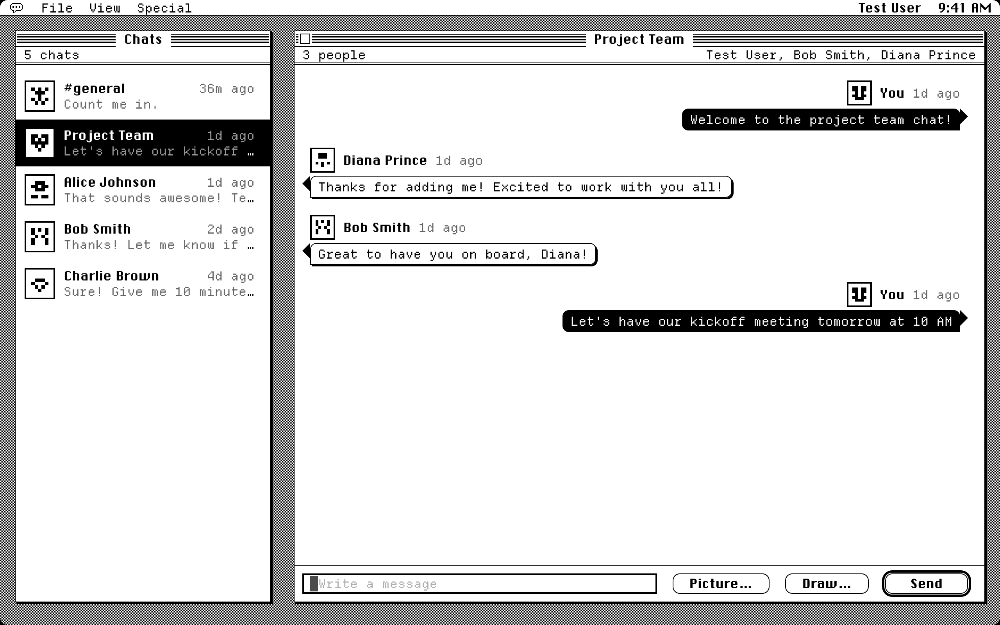
</picture>

## What it does

- **Invite-only.** Nobody can sign up without a link from someone already in. **File → Invite a Friend…** makes one; it works once and lasts a week. Whoever signs up with it lands in a chat with you, and you get told they joined.
- **Direct chats, groups and `#channels`.** Start a chat with anyone from **File → New Chat…** or <kbd>Ctrl</kbd>&nbsp;<kbd>K</kbd>. Make a channel with **File → New Channel…** and bring people in with **Add People…**, or join one from **File → Join Channel…** or by typing `/join #name` in the message box.
- **Live.** Messages arrive the moment they're sent, and the chat list reorders itself. Yours shows the moment you press Send, the wristwatch beside it until it's there, and the next can follow at once; one that couldn't be sent says so, with Try Again. When the connection drops, the chat's title bar says it's reconnecting, and it catches up once it's back.
- **Your place, kept.** Each day in a chat is named, and each run of someone's messages timed by the clock. Scroll up and earlier messages keep coming, as far back as the chat goes, without moving what you're reading; read further up and new messages wait below, unread, with a button to them, rather than pulling you down.
- **Unread at a glance.** A chat with messages you haven't read shows how many, and the installed app's icon on your Home Screen or Dock shows them all; with notifications on, even while it's closed.
- **The wristwatch while someone types.** While someone writes to you, the chat window's title bar shows the classic Macintosh watch, its hand going round, and "Ana is typing…". It goes the moment their message arrives.
- **Get Info on any message.** Click a message (beside its picture, if it has one), or hold a finger on it: what it is and how big, where and when it was sent, and who has read it and when. A chat counts as read while it's open on your screen.
- **Pixel emoji.** Every emoji is redrawn as black-and-white pixel art in the theme's ink, and a message of just emoji shows them big.
- **MacPaint drawings.** **Attach → Draw…** opens a paint window with a pencil, brush, paint bucket, eraser and eight patterns, and attaches the picture to your message. **Draw on It** opens any picture in the chat to add to it.
- **Photos, the 1984 way.** **Attach → Picture…**, pasting or dropping a photo dithers it to black and white on your device, up to 320 pixels a side, to send with or without text. Only the dithered picture leaves your device, in a few kilobytes. Click or tap a picture or movie to see it full screen, in a window of its own; click or tap again to close it.
- **Movies, like it's 1984.** **Attach → Movie…**, pasting or dropping a video lets you pick up to six seconds of it on a timeline, and makes it a black-and-white movie on your device: 8 frames a second, up to 320 pixels a side, looping in the chat like a GIF. Draw on it like a picture. A movie is coded pixel by pixel against the frame before, so six seconds take some 40 KB.
- **Sounds, squashed on purpose.** **Attach → Sound…** records up to a minute, or takes a song or any sound file (or drop one on the chat) and lets you pick up to a minute of it on its timeline. It's squashed on your device the way photos are dithered: 8,000 samples a second, each sliver of sound kept as rough steps of each band's loudness, with the rest played back as noise. It comes out crunchy, like an old Mac, and a minute of speech or music takes about 30 KB.
- **Profiles.** File → **Profile…** changes your name and your face: draw one, or dither a photo's middle to 64×64. Remove it and you're the pattern you started as. Everyone who shares a chat with you sees the change at once.
- **Link previews.** Links are clickable, and the first in a message gets a card with the page's site, title, description and its picture dithered to 64×64. Our server reads the page, fenced in so it can only reach the public internet, so linked sites never see who's reading.
- **Notifications, even with Msgr closed**, on computers and phones, for messages in chats you aren't looking at. Msgr offers them once on each device, and keeps them in the **Special** menu. On an iPhone, add Msgr to the Home Screen first (Share → Add to Home Screen); elsewhere it can be installed as an app from the **Special** menu. A beep sounds while it's open.
- **Light, dark and seven tints** from the **View** menu, and a layout that works on a phone.

<p align="center">
  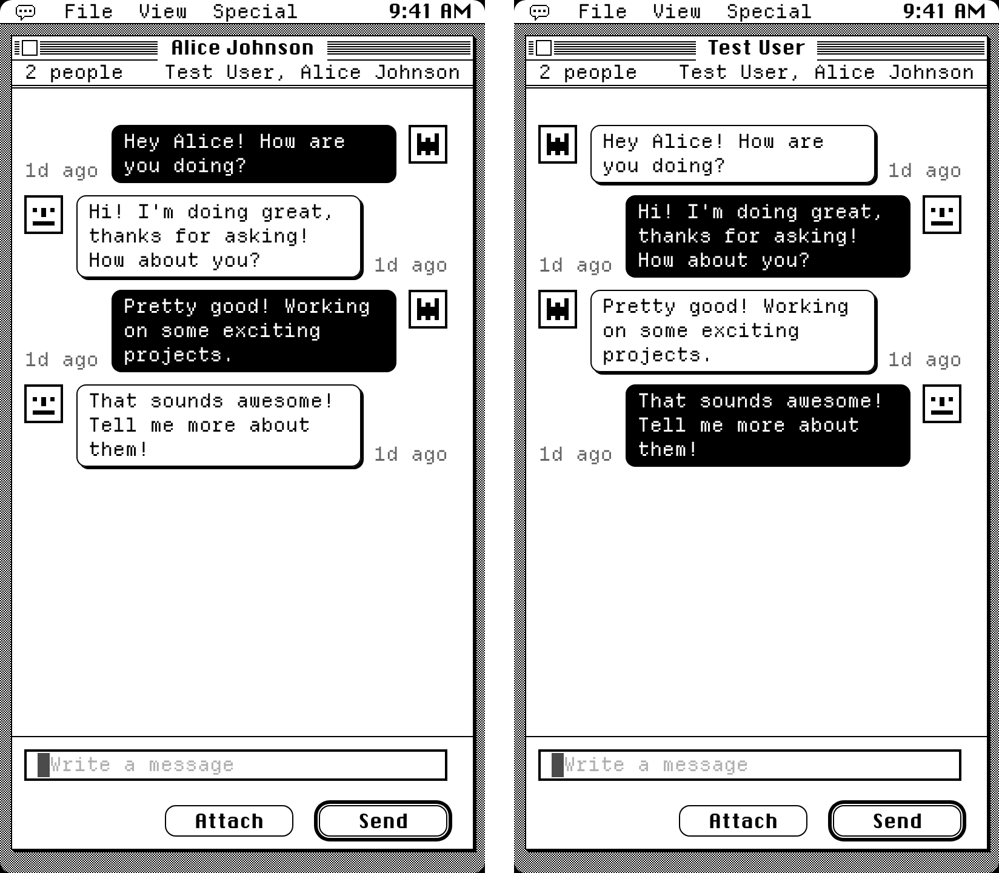
</p>

<table>
  <tr>
    <td width="50%" align="center">
      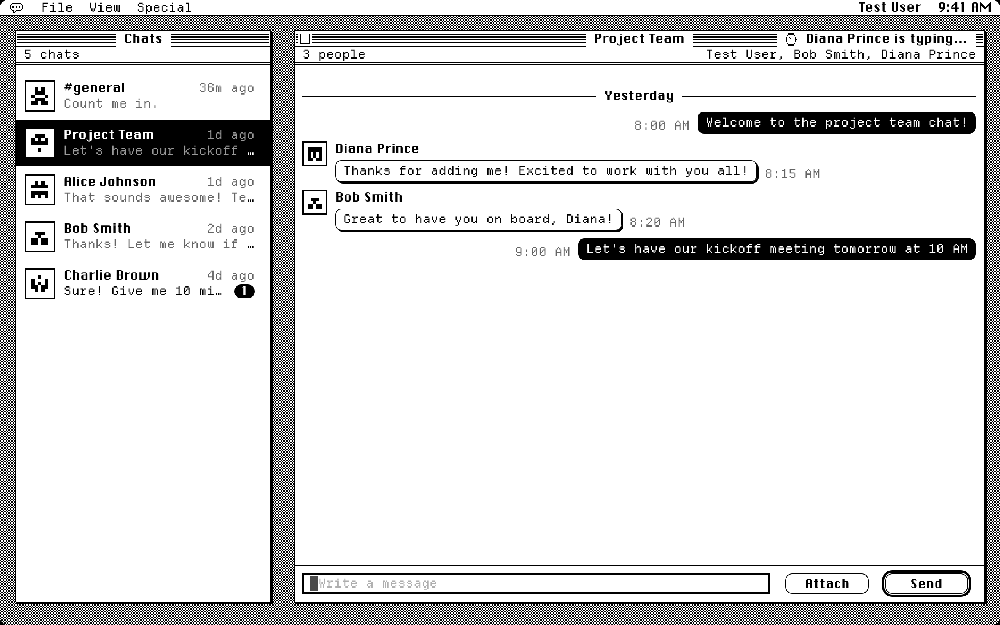
      <br><sub>Someone typing</sub>
    </td>
    <td width="50%" align="center">
      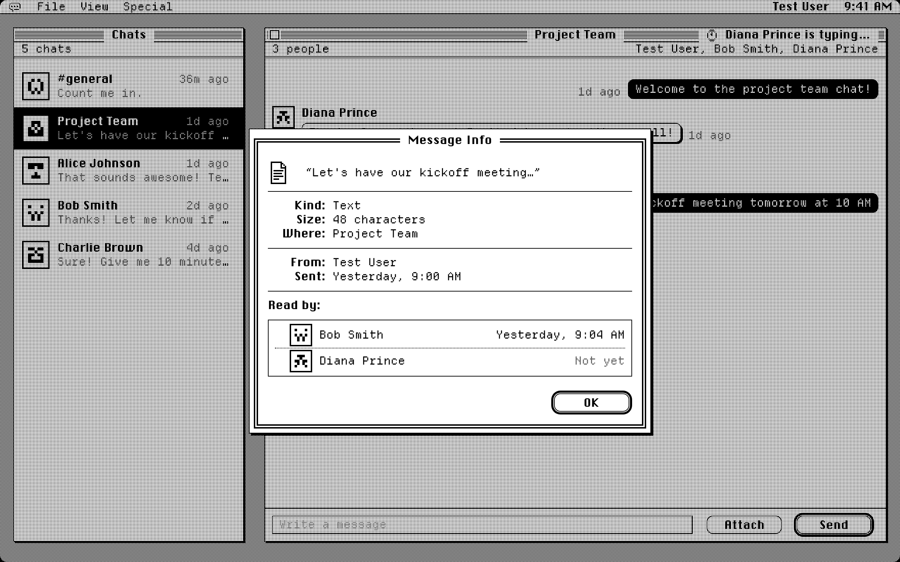
      <br><sub>Get Info: who has read it, and when</sub>
    </td>
  </tr>
</table>

<table>
  <tr>
    <td width="50%" align="center">
      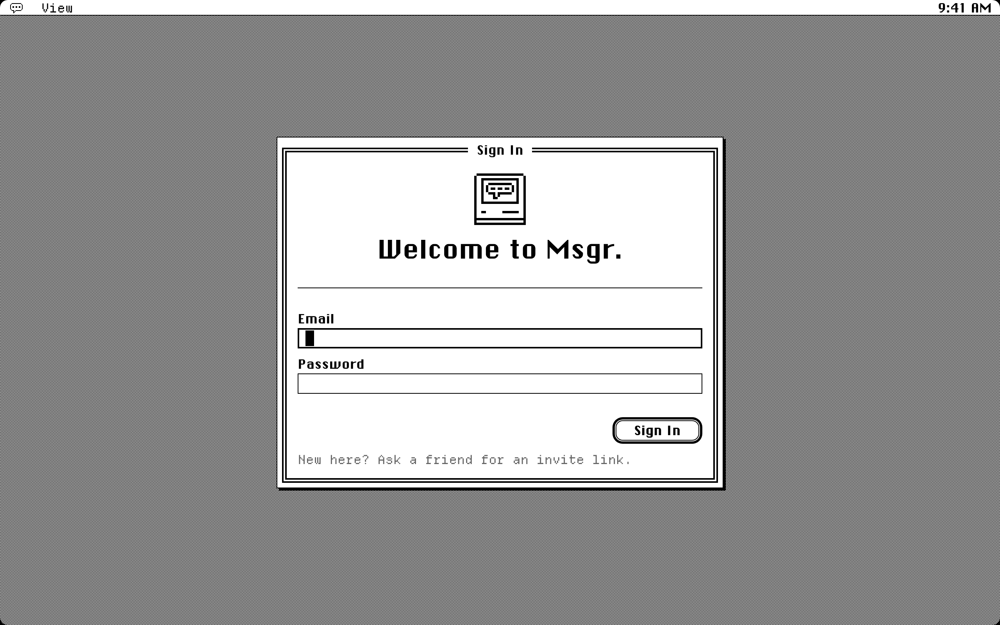
      <br><sub>Signing in</sub>
    </td>
    <td width="50%" align="center">
      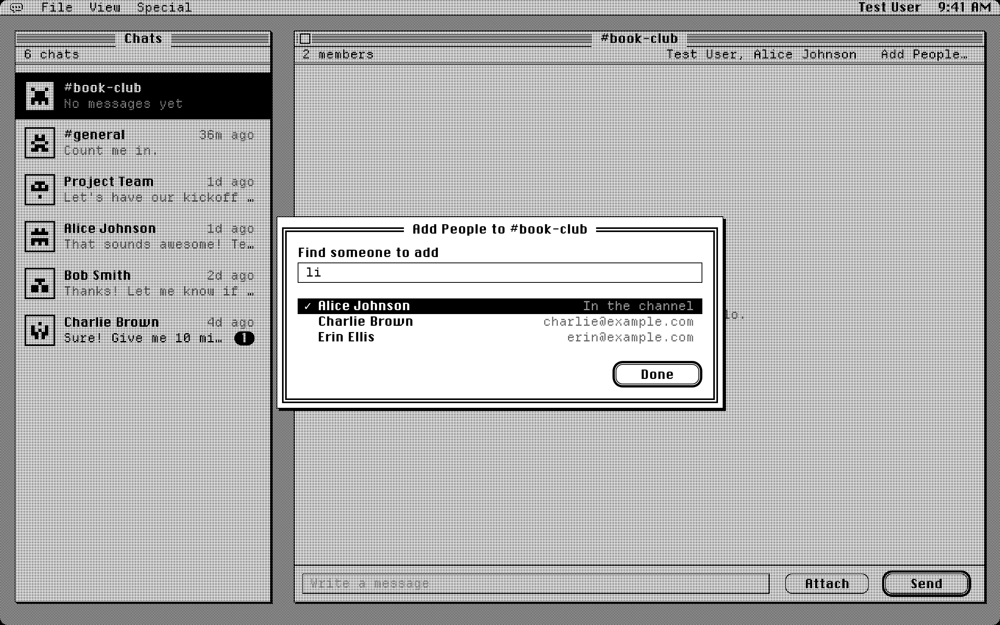
      <br><sub>Adding people to a new channel</sub>
    </td>
  </tr>
</table>
<p align="center">
  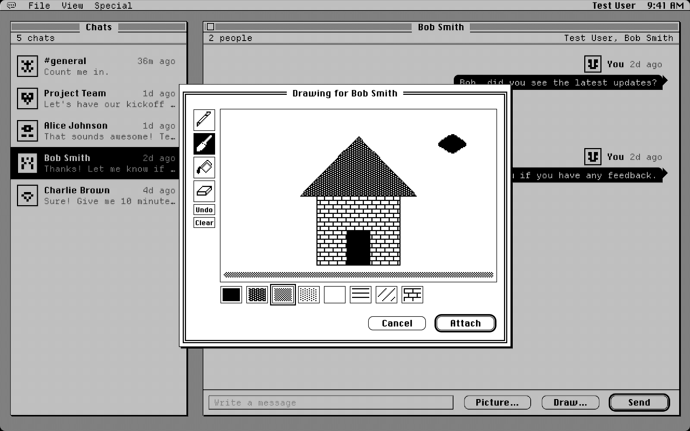
</p>
<p align="center">
  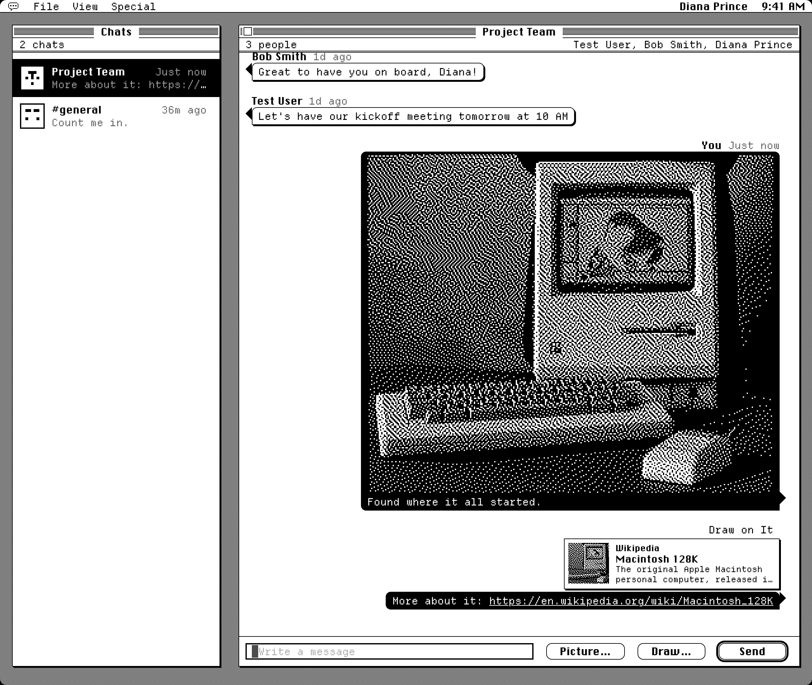
  <br><sub>A photo and a link. Photo: Bernard Gotfryd, January 1984, public domain (Library of Congress).</sub>
</p>

<table>
  <tr>
    <td width="76%" align="center">
      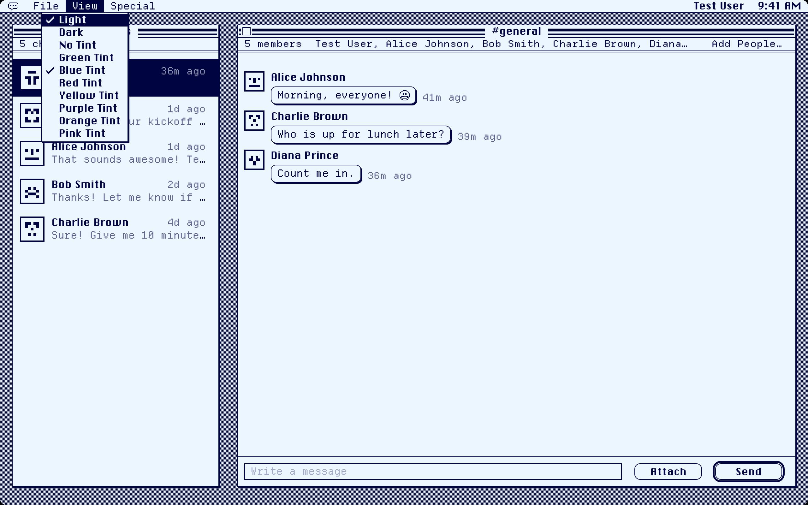
      <br><sub>Themes, from the View menu</sub>
    </td>
    <td width="24%" align="center">
      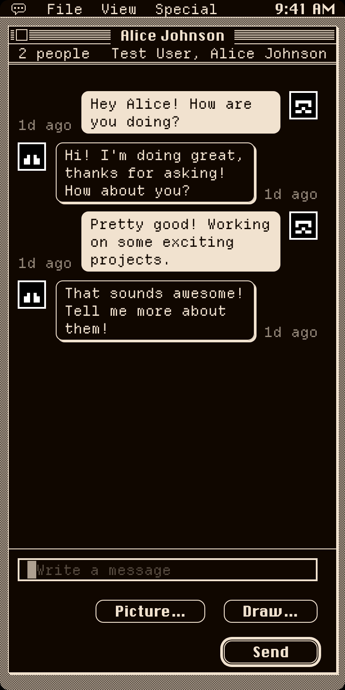
      <br><sub>On a phone</sub>
    </td>
  </tr>
</table>

## Run it locally

You need Node.js 22 or newer. The database comes from Prisma's local dev server, so there's no Postgres to install.

```bash
npm install
npm run db:start          # in its own terminal; press h for its URL, and keep it running
cp apps/api/.env.example apps/api/.env   # then set DATABASE_URL to that URL
npm run db:setup          # migrate, generate the Prisma client, seed
npm run dev               # API on :4000, app on http://localhost:4200
```

The app proxies `/graphql` to the API, the same single-address setup production uses. Run `npm run db:migrate` whenever you pull a new migration.

The seed creates six people, all with the password `password123`, and five chats: three direct, the "Project Team" group and `#general`. Erin is in none of them; the e2e makes her its admin.

| Email               | Name          |
| ------------------- | ------------- |
| test@example.com    | Test User     |
| alice@example.com   | Alice Johnson |
| bob@example.com     | Bob Smith     |
| charlie@example.com | Charlie Brown |
| diana@example.com   | Diana Prince  |

## Invite people

Signed in, use **File → Invite a Friend…** and send the link. With nobody signed up yet, print the first one from the command line:

```bash
npm run invite
```

## How it's built

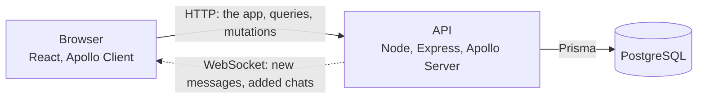

- **API:** Node, Express and Apollo Server; GraphQL over HTTP and, for the live feed, over WebSocket. Prisma on PostgreSQL, DataLoader for batching. It's a functional core with an imperative shell: pure domain rules, use cases behind ports, and adapters at the edges.
- **App:** React 19, Apollo Client and Vite, built from [Sacred Computer](https://www.sacred.computer/)'s components and dressed as a 1984 Macintosh by one skin stylesheet. Set in Chicago and Departure Mono.
- **Security:** invite-only accounts, an httpOnly session cookie for HTTP and WebSocket alike, a strict Content-Security-Policy, and throttled logins. See [SECURITY.md](SECURITY.md).
- **Tooling:** an Nx monorepo, Vitest, Playwright, and GitHub Actions running every check, including the repository contract against real Postgres and the browser tests against the production build.

Read more:

- [docs/architecture.md](docs/architecture.md): the big picture, and how a message travels.
- [docs/adr/](docs/adr/): why it's built this way, one decision at a time.
- [CLAUDE.md](CLAUDE.md): conventions, the TDD workflow and gotchas, for anyone changing the code.
- [CONTEXT.md](CONTEXT.md): the vocabulary: chat, channel, participant, invite.
- [docs/manual-testing.md](docs/manual-testing.md): a checklist for trying every feature by hand.
- [docs/deploying.md](docs/deploying.md): running it on a server.

<details>
<summary><b>Scripts</b></summary>

| Script                | What it does                                                              |
| --------------------- | ------------------------------------------------------------------------- |
| `npm run dev`         | API and app in parallel (`dev:api`, `dev:frontend`)                       |
| `npm run test`        | Every test; the Postgres contract also runs if `TEST_DATABASE_URL` is set |
| `npm run e2e`         | Build, then browser tests in a fresh `msgr_e2e` database (see CLAUDE.md)  |
| `npm run screenshots` | Build, then remake this README's pictures in `docs/screenshots`           |
| `npm run typecheck`   | Type check both apps (runs codegen first)                                 |
| `npm run lint`        | Lint both apps, including the API's layer rule                            |
| `npm run build`       | Build both apps                                                           |
| `npm run codegen`     | Generate GraphQL types for the API and the app                            |
| `npm run db:start`    | Start the Prisma dev database                                             |
| `npm run db:migrate`  | Apply migrations (and create one after a schema change)                   |
| `npm run db:generate` | Generate the Prisma client                                                |
| `npm run db:seed`     | Reset chats and seed test data                                            |
| `npm run db:setup`    | migrate + generate + seed                                                 |
| `npm run invite`      | Print a single-use sign-up link                                           |

</details>

<details>
<summary><b>Project structure</b></summary>

```
apps/
├── api/
│   ├── prisma/              # schema, migrations, seed
│   ├── scripts/             # create-invite (npm run invite)
│   └── src/
│       ├── domain/          # pure types and rules (functional core)
│       ├── application/     # use cases, ports, DataLoaders
│       ├── infrastructure/  # Prisma, bcrypt, JWT, PubSub and throttle adapters
│       ├── graphql/         # schema, resolvers, context, server
│       ├── testing/         # in-memory adapters, repository contract, test harness
│       └── main.ts          # composition root
├── frontend/
│   ├── public/              # fonts, boot script
│   └── src/
│       ├── app/             # pages, Mac chrome, chat windows and dialogs, hooks
│       ├── lib/             # pure logic with tests, generated GraphQL types
│       ├── sacred/          # vendored Sacred Computer components
│       └── skin.css         # the Macintosh skin
└── e2e/                     # Playwright: browser tests and the README's screenshots
docs/                        # architecture, decision records, deploying, screenshots
Dockerfile, render.yaml      # the production container, and its Render service
```

</details>

## Troubleshooting

**Database connection issues?** Make sure `npm run db:start` is running and ports 51213–51215 are free.

**TypeScript errors after pulling?** Run `npm run codegen` and `npm run db:generate`, and `npm run db:migrate` if there are new migrations.

**Live updates not arriving?** Sign out and in again (the session cookie authenticates the WebSocket), and check the API is running.

## Credits

The interface is built from [Sacred Computer](https://www.sacred.computer/) by Internet Development Studio (MIT; see `apps/frontend/src/sacred/LICENSE.md`), and set in Chicago FLF and Departure Mono from Sacred's font menu. The look is a homage to the original Macintosh; Msgr has nothing to do with Apple, and its icons are its own.
